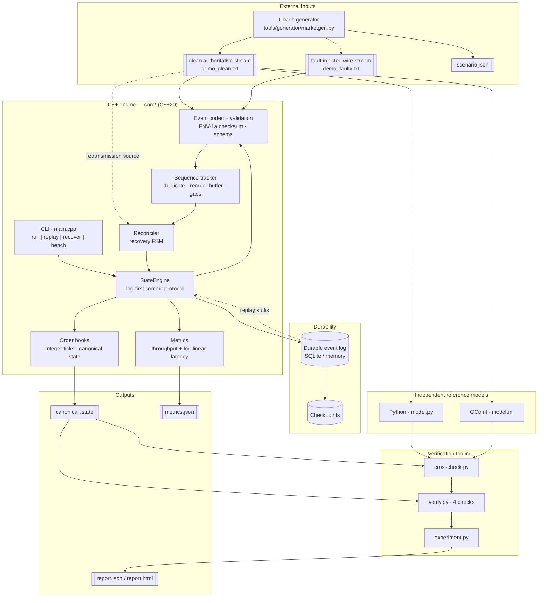
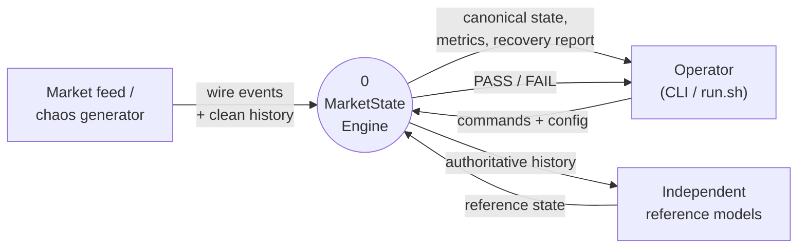
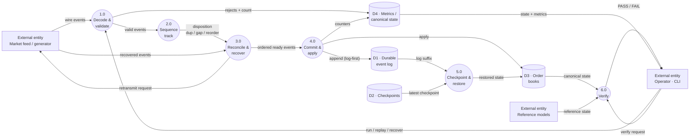
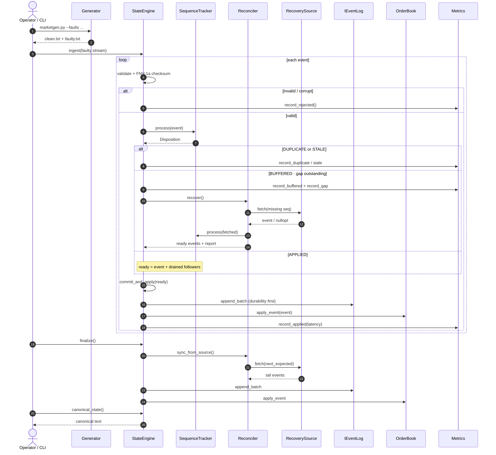
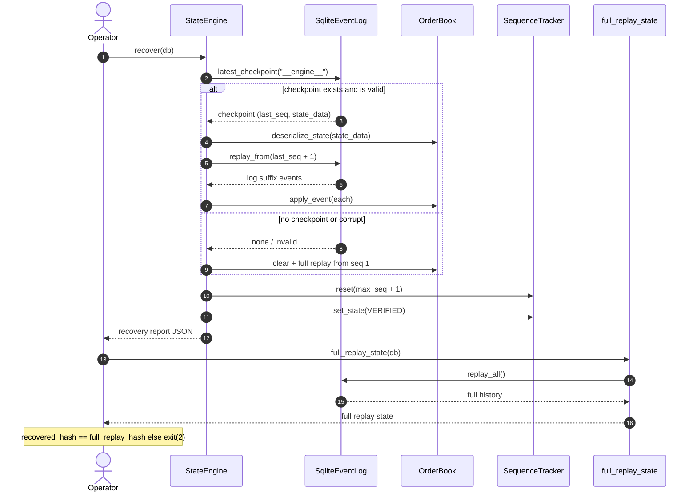
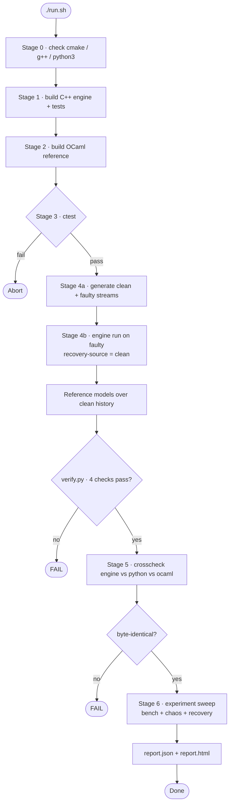
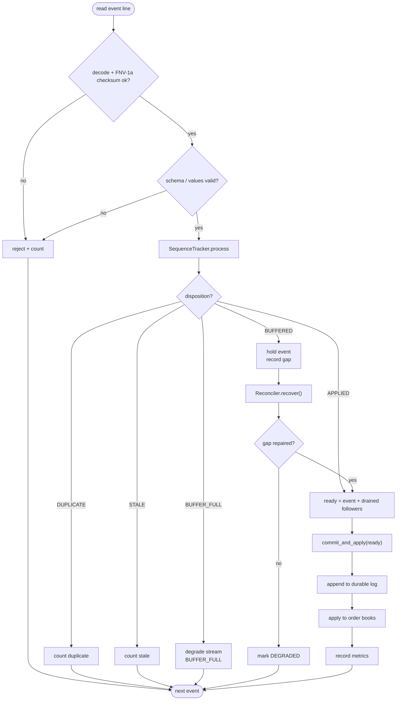

# MarketState

**Deterministic Real-Time Market State Reconstruction & Recovery Engine**

MarketState is a fault-tolerant, event-driven market-data processing engine. It
ingests a stream of market events that may be **duplicated, delayed, missing,
reordered, or corrupted**, maintains a deterministic market state (limit order
book + activity statistics), recovers that state after gaps or process crashes,
and **independently verifies** that the result is correct.

It is not a matching engine. The order book is the application domain; the real
project is the correctness and recovery infrastructure around it.

---

## The problem

A financial data system receives events and builds an internal market state.
Delivery, however, is unreliable: the same event may arrive twice, events may
arrive out of order, some may never arrive, and the process may crash with
in-memory state lost. The system must be able to answer:

> Can I still trust my internal market state?

MarketState answers this with three connected capabilities:

1. **Detect** — duplicates, sequence gaps, reordering, corruption.
2. **Reconstruct** — repair gaps from a retransmission source, and restore state
   from a durable log + consistent checkpoint after a crash.
3. **Verify** — prove the reconstructed state equals the state implied by the
   authoritative event history, using an independent reference model.

A system that reports "recovery complete" without proving correctness is not
enough. MarketState provides the proof.

---

## Architecture

```
            clean authoritative stream            fault-injected "wire" stream
                        │                                    │
                        ▼                                    ▼
   ┌───────────────────────────────────────────────────────────────────┐
   │  C++ engine (core/)                                                │
   │                                                                    │
   │  Event codec + validation ──▶ Sequence tracker ──▶ Reconciler      │
   │  (checksum, schema)          (dup/gap/reorder)    (recovery FSM)   │
   │                                        │                  ▲        │
   │                                        ▼                  │        │
   │                 commit protocol: append log, then apply  │ source │
   │                                        │                  │        │
   │             ┌──────────────────────────┴──────────┐       │        │
   │             ▼                                      ▼      │        │
   │        Durable event log (SQLite)            State engine ─┘        │
   │        + checkpoints                          (order books)         │
   │             │                                      │               │
   │             └──────────────► Recovery manager ◀────┘               │
   │                              (checkpoint + replay)                 │
   │                                                                    │
   │  Metrics: throughput, p50/p95/p99/p99.9 latency, fault accounting  │
   └───────────────────────────────────────────────────────────────────┘
                        │                                    ▲
                        ▼                                    │
   ┌───────────────────────────────────────────────────────────────────┐
   │  Tooling                                                            │
   │  Python generator + chaos engine                                    │
   │  Independent reference models: Python  +  OCaml  (must agree)       │
   │  verifier · cross-check · experiment runner · HTML dashboard        │
   └───────────────────────────────────────────────────────────────────┘
```

### Modules

| Module | Responsibility |
| --- | --- |
| `event.hpp/.cpp` | Canonical event schema, checksummed text codec, validation |
| `order_book.hpp/.cpp` | Integer-tick incremental book, canonical state serialization |
| `sequence_tracker.hpp/.cpp` | Duplicate detection, bounded reorder buffer, gap tracking |
| `reconciler.hpp/.cpp` | Recovery state machine, retransmission source abstraction |
| `event_log.hpp/.cpp` | Durable log + checkpoints (`IEventLog`, memory + SQLite) |
| `state_engine.hpp/.cpp` | Commit protocol, checkpoint, recovery, crash hooks |
| `metrics.hpp/.cpp` | Throughput and log-linear latency histograms |
| `main.cpp` | CLI: `run`, `replay`, `recover`, `bench` |

### Key design decisions

- **Integer ticks, never floats.** Prices and quantities are `int64_t`. This
  makes replay, checkpoint/recovery, and cross-implementation comparison exact.
- **Checksum covers the whole record.** Corruption anywhere (header or payload)
  is detected; a corrupt event is rejected, never silently applied.
- **Canonical state.** All state is serialized to a stable, sorted text form so
  two engines — or an engine and the reference model — can be compared
  byte-for-byte.
- **Log-first commit protocol.** Events are appended durably *before* being
  applied in memory. A crash after the append but before the apply is repaired
  on restart by replaying the log; a crash before the append leaves both log and
  state untouched.
- **No silent advancement past a gap.** When sequence 103 is missing, buffered
  events are held and the affected stream is marked `GAP_DETECTED` / `DEGRADED`
  until the gap is repaired. The state is never silently relabeled "current".

---

## System diagrams

The diagrams below use [Mermaid](https://mermaid.js.org/) and render on GitHub and
in Mermaid-aware Markdown viewers.

### System architecture (components)



### Data flow diagram

**DFD Level 0 — context.** The whole engine as one process with its external
entities.



**DFD Level 1 — major processes and data stores.** Rounded nodes are processes,
cylinders are data stores, rectangles are external entities.



### Sequence diagrams

**Ingest path** — validation, sequence tracking, gap recovery, log-first commit.



**Crash recovery path** — `recover --db`, checkpoint restore, log-suffix replay,
and equivalence check against a full replay.



### Flowcharts

**Overall pipeline** — the `./run.sh` stages from build to report.



**Per-event ingestion** — the decision path for a single event line.



---

## Build

Requirements: CMake ≥ 3.20, a C++20 compiler, SQLite3, GoogleTest (for tests),
Python 3 (stdlib only). OCaml is optional and only needed for the second
independent reference model (`reference/ocaml/`); see its README for install
options, including a rootless user-local extraction.

```bash
cmake -S . -B build -DCMAKE_BUILD_TYPE=Release -DBUILD_TESTS=ON
cmake --build build -j
ctest --test-dir build --output-on-failure      # or: ./build/core/marketstate_tests
```

## Quick start

One command builds everything, runs the tests, generates a fault-injected
stream, recovers it, verifies against the independent reference models, and
produces the performance report:

```bash
./run.sh                 # full run (default 100k-event demo, full sweep)
./run.sh 200000          # full run with a 200k-event demo stream
```

Useful overrides:

```bash
SKIP_EXPERIMENTS=1 ./run.sh          # build + test + demo + cross-check only
SKIP_TESTS=1       ./run.sh          # skip the unit-test step
SIZES=10000,100000 ./run.sh          # lighter experiment sweep
SEVERITIES=light   ./run.sh          # single chaos severity
REFERENCE=ocaml    ./run.sh          # verify against the OCaml reference model
```

The headline output is `data/report.html`. The individual stages can also be run
by hand:

```bash
# 1. Generate a clean stream and a corrupted/reordered/duplicated one.
python3 tools/generator/marketgen.py --events 100000 --seed 7 \
  --out data/demo_clean.txt --faulty-out data/demo_faulty.txt \
  --scenario-out data/demo_scenario.json \
  --faults "drop=0.03,dup=0.03,reorder=0.05,corrupt=0.02"

# 2. Ingest the faulty stream and recover it using the clean stream as the
#    retransmission source.
./build/core/marketstate run --events data/demo_faulty.txt \
  --recovery-source data/demo_clean.txt \
  --state-out data/demo_engine.state --metrics-out data/demo_engine.metrics.json

# 3. Independent reference models over the authoritative history.
python3 reference/python/model.py --events data/demo_clean.txt \
  --state-out data/demo_ref.state
reference/ocaml/build.sh && reference/ocaml/_build/model \
  --events data/demo_clean.txt --state-out data/demo_ref_ml.state

# 4. Engine and both references must match exactly.
diff data/demo_engine.state data/demo_ref.state && \
diff data/demo_engine.state data/demo_ref_ml.state && echo "VERIFIED"
```

The individual stage scripts remain available:

```bash
scripts/run_demo.sh          # generate → fault → recover → verify
scripts/run_experiments.sh   # full sweep + HTML dashboard (data/report.html)
```

## CLI

| Command | Purpose |
| --- | --- |
| `marketstate run --events F [--db D] [--checkpoint-interval N] [--recovery-source S]` | Ingest, optionally log + checkpoint, optionally repair gaps |
| `marketstate replay --events F` | Pure deterministic replay (no durability) |
| `marketstate bench --events F --repeat N` | Throughput + latency percentiles |
| `marketstate recover --db D` | Restore from checkpoint + replay log suffix, and verify equivalence |

## Independent reference models

Correctness is not asserted against a copy of the engine — it is checked against
independent re-implementations that share no code with it:

| Reference | Language | Strategy |
| --- | --- | --- |
| `reference/python/model.py` | Python | levels recomputed from the raw order set |
| `reference/ocaml/model.ml` | OCaml | same semantics, typed variant/`Hashtbl` impl |

Both consume the same authoritative history and emit the same canonical text as
the C++ engine. `tools/analyzer/crosscheck.py` runs all three and fails unless
their states are **byte-identical**:

```bash
tools/analyzer/crosscheck.py --events data/demo_clean.txt
```

```
{ "hashes": { "engine": "b3e7cb0c…", "python": "b3e7cb0c…", "ocaml": "b3e7cb0c…" },
  "all_equal": true }
```

The verifier can be run against either reference with
`verify.py --reference {python,ocaml}`; `experiment.py` accepts the same flag.

## Verification

`tools/analyzer/verify.py` runs four checks:

1. **Differential correctness** — `engine(clean) == reference(clean)`.
2. **Deterministic replay** — running the same history twice yields identical state.
3. **Recovery equivalence** — `engine(chaos + retransmit) == reference(clean)`
   (i.e. `S_checkpoint+replay == S_full replay`).
4. **Honest degradation** — with a genuinely unreliable stream and no recovery
   source, the engine state differs from the authoritative reference (it does
   not pretend to be correct).

## Results (this machine)

Reproducible via `scripts/run_experiments.sh` (seed 42). Full data in
`data/report.json` / `data/report.html`.

**Throughput & latency (single thread, clean stream):**

| Events | Throughput | p50 | p95 | p99 | p99.9 |
| ---: | ---: | ---: | ---: | ---: | ---: |
| 10 000 | ~817 K eps | 256 ns | 512 ns | 2.3 µs | 15.4 µs |
| 100 000 | ~838 K eps | 288 ns | 640 ns | 2.6 µs | 6.1 µs |
| 1 000 000 | ~829 K eps | 320 ns | 704 ns | 2.6 µs | 5.6 µs |

**Chaos recovery — final state equality vs. independent reference model, 1M events:**

| Severity | Dropped | Duplicated | Corrupted | Recovered | Unresolved | Equivalent |
| --- | ---: | ---: | ---: | ---: | ---: | :---: |
| light | 10 054 | 9 801 | 5 028 | 33 879 | 0 | ✅ |
| medium | 30 205 | 29 229 | 20 027 | 91 907 | 0 | ✅ |
| heavy | 80 167 | 55 349 | 48 810 | 194 335 | 0 | ✅ |

Every scenario (10K/100K/1M × light/medium/heavy) recovers to a byte-identical
state. Checkpoint + replay recovery is equivalent to full replay at all sizes.

## Project layout

```
MarketState/
├── run.sh              one-command build / test / demo / verify / benchmark
├── OVERVIEW.md         full project guide: purpose, architecture, data & output flow
├── core/               C++20 engine + GoogleTest suite
├── reference/python/   independent reference model (Python)
├── reference/ocaml/    independent reference model (OCaml)
├── tools/generator/    event generator + chaos injector
├── tools/analyzer/     verifier, cross-check, experiment runner, HTML dashboard
├── scripts/            demo + experiment runners
├── config/             example configuration
├── data/               generated streams, logs, reports
└── docs/               architecture and verification notes
```

## Scope and honesty

Recovery requires *sufficient information*: a retransmission source or an
authoritative snapshot. If an event is permanently lost and no source exists,
MarketState does not invent it — it reports the unresolved gap and marks the
state `DEGRADED`. Every quoted number is produced by the actual implementation
and the exact configuration is stored alongside the run.
